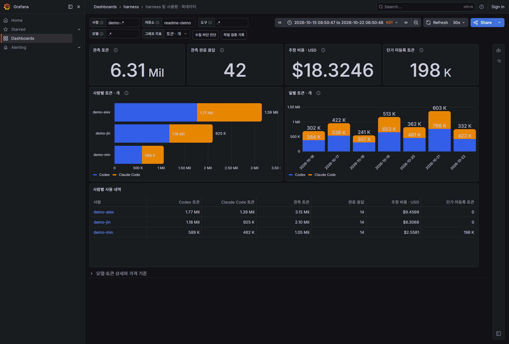
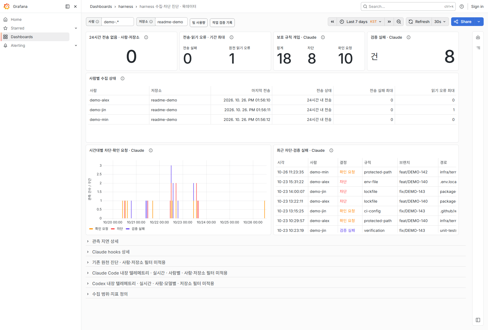
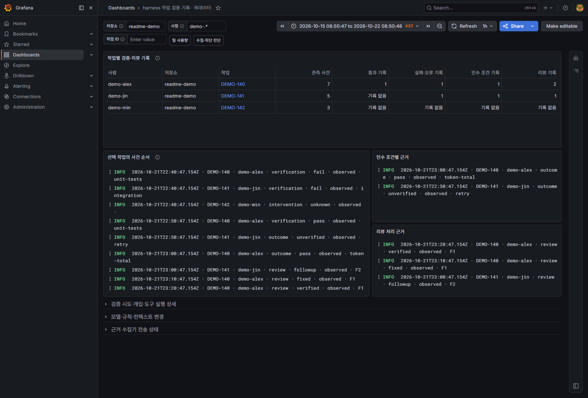
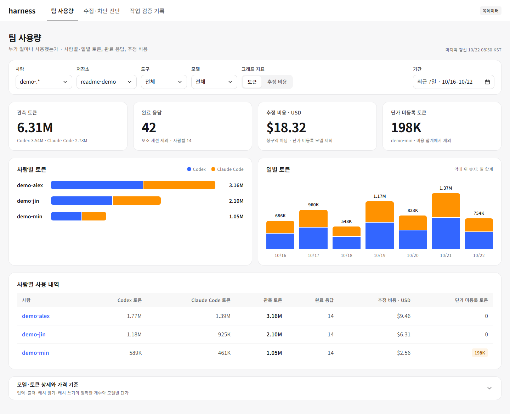
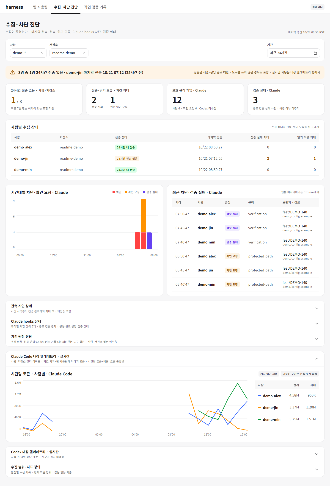
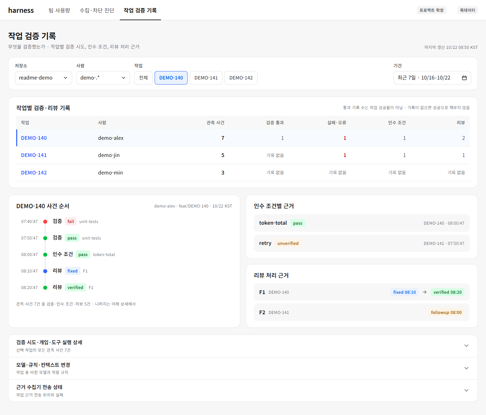

# ai-dev-harness

AI 코딩 도구로 개발하는 팀 프로젝트에, 저장소를 만든 날부터 붙여 쓰는 **개발 가드레일 키트**다.
규칙 문서, 플랜·리뷰 절차, hooks, CI 검사, 스캐폴드, 측정을 한 벌로 제공해 AI 산출물이
표준을 벗어나면 기계가 막고, 그 효과를 숫자로 보이는 것을 목표로 한다.

SSAFY 2학기 프로젝트(feelm)에서 실제로 운용한 AI 작업 절차를 일반화한 것이 출발점이며,
키트 저장소 자신도 이 키트로 관리한다(자기 적용).

## 지금 할 수 있는 것 (0.3.0)

0.3.0의 중심은 **AgentOps**다(M5). 에이전트 세션을 기록하고 비용을 추정하고, hooks가 없는 도구의 변경도 MR에서 같은 규칙으로
막고, 그 결과를 주간 지표와 실시간 대시보드로 본다. 0.2.0에서 올리는 방법은 [설치 가이드 13.1절](docs/install.md)에 있다.

```bash
# 새 저장소나 기존 저장소에 규칙 파일 한 벌을 생성한다
python bin/harness.py init ../my-project --platform gitlab --tracker jira --issue-prefix ABC123

# 영역 디렉터리에 판정·절차 규칙(AGENTS.md)을 생성한다. 루트 init 이후에 실행한다
python bin/harness.py init ../my-project --area backend --verify-cmd "cd backend && ./gradlew build"

# 생성된 파일이 템플릿과 어긋났는지 검사한다(영역 파일 포함)
python bin/harness.py check ../my-project
```

생성되는 파일: 루트 `AGENTS.md`·`CLAUDE.md`, `docs/`의 문서 역할·AI 병렬 작업·Git 컨벤션·
개발 흐름·Secret 규칙, 플랜·리뷰·ADR 템플릿, 병합 요청 템플릿, Claude Code hooks(`.claude/`, [설명](core/hooks/README.md)). 자리표시자는 플랫폼(GitLab·GitHub)과
업무 추적(Jira·GitHub Issues)에 맞춰 치환된다. 목록은 `core/templates/manifest.json`이 정의한다.

영역 `AGENTS.md`는 변경을 경량·표준·엄격 세 단계로 판정하고, 단계마다 플랜·리뷰 절차를 정한다.
영역 설정(검증 명령, 트리거, 리뷰 관점, 기준 문서)은 `harness.json`의 `areas`에 기록되며,
`--trigger`·`--review-focus`를 생략하면 키트 기본값을 쓰고, 기준 문서는 `--area-doc`으로 준 것만 적는다.

| 영역 | 명령·조각 | 하는 일 |
| --- | --- | --- |
| 판정·절차 | `judge`, `judge --eval`, `lint-plans`, `review summary` | 변경 파일로 경량·표준·엄격 판정, 플랜·리뷰 파일 형식 검사, 리뷰 처리 표 요약(M2·M5) |
| 스캐폴드 | `init --area --profile`, `scaffold` | spring-java·react-ts·android-kotlin·android-konsist 프로필의 컨벤션 테스트와 템플릿(M3) |
| CI 조각(GitLab) | `core/ci/gitlab/*.yml` | 보안 검사 4종, MR 본문 lint(보호 경로 확인 포함), 변경 영역 검증, 주간 측정 예약 파이프라인 |
| hooks | `.claude/hooks/` | 보호 경로 차단·확인, 종료 검증, 세션 기록(시작·응답·종료)과 토큰 수 |
| 에이전트 기록 | `sessions summary`, `agent summary`, `events summary` | 브랜치의 세션·응답·작업 시간·토큰·추정 비용·hooks 개입을 MR 본문 절로(M5) |
| 측정 | `metrics collect`·`report`·`notify`, `classify-ci` | 플랫폼 API에서 주별 지표 1~8을 모아 HTML 리포트와 요약 메시지로(M4·M5) |
| 실시간 | `dashboard`, `telemetry setup`·`doctor`·`push`, `core/observability/` | 로컬 실시간 대시보드(127.0.0.1), 선택: 팀 수집기·Grafana 대시보드, 팀원 PC의 Claude Code·Codex 내장 텔레메트리 설정·점검(M5, #145) |

## 팀 대시보드

Claude Code와 Codex의 **사람별 사용량, 수집 문제, 작업 검증 근거**를 나눠 본다.
아래는 공통 수집 v2(#140)와 프로젝트 확장을 적용한 화면 예시다. 모든 스크린샷은 로컬 Grafana에
가상 팀원과 `readme-demo` 저장소의 목데이터를 넣어 촬영했다. 실제 팀 사용량이나 비용이 아니다.

| 화면 | 확인할 내용 |
| --- | --- |
| **팀 사용량** | 누가 얼마나 사용했는가. 사람별·일별 토큰, 완료 응답, 추정 비용 |
| **수집·차단 진단** | 수집이 끊겼는가. 마지막 수신, 전송·읽기 오류, Claude hooks 차단·검증 실패 |
| **작업 검증 기록** | 무엇을 검증했는가. 작업별 검증 시도, 인수 조건, 리뷰 처리 근거 |

### 팀 사용량

토큰 수를 기본으로 보여 주며 그래프 지표를 추정 비용으로 바꿀 수 있다. 한 사람의 막대 안에서
Codex와 Claude Code를 함께 비교한다. 단가 미등록 모델도 토큰에는 포함하고 비용에서는 제외한다.
모델별 상세 표에서는 입력·출력·캐시 읽기·캐시 쓰기의 정확한 개수를 확인한다.



<details>
<summary>수집·차단 진단 화면 보기</summary>

사람·저장소별 마지막 전송과 24시간 전송 없음을 먼저 보고, 시간대별 Claude 차단·확인 요청과 실패 사건을 확인한다.
키트는 세션·응답이 끝날 때만 보내므로 24시간 전송 없음은 도구를 쓰지 않은 경우도 포함하며, 에이전트가 실행 중인지
알려 주는 값도 아니다.



</details>

<details>
<summary>작업 검증 기록 화면 보기 · 프로젝트 확장</summary>

작업을 선택해 검증·인수 조건·리뷰 기록을 좁혀 본다. 검증 통과 기록 수는 작업 성공률이 아니며,
기록이 없으면 성공으로 채우지 않는다. 이 화면과 근거 수집기는 프로젝트 확장으로 별도 적용한다.



</details>

<details>
<summary>화면 구성 목업 보기 · 설계 시안(#156)</summary>

아래는 실제 Grafana 화면이 아니라 화면 구성을 합의할 때 쓴 **설계 목업**이다(Wanted Design System 토큰, 가상 팀원 목데이터).
Grafana에는 패널 구성·제목·배치·색을 반영하며, 탭·배지·알림 박스·글꼴 같은 겉모양은 실제 화면과 다르다.
수집·차단 진단 목업은 Claude Code 내장 텔레메트리 행(사람별 시간당 토큰, 캐시 읽기 제외)을 펼친 모습이다.







</details>

팀 Grafana는 [팀 수집기 안내](core/observability/README.md)에 따라 선택해서 운영한다.
기본 키트의 기존 원천 진단과 공통 수집 v2 적용 여부를 구분해서 사용한다.
수집기 없이 혼자 확인하려면 [로컬 대시보드](core/dashboard/README.md)를 쓴다.

## 구조

```text
bin/harness.py     명령 진입점(init · check · judge · scaffold · metrics · dashboard 등). 표준 라이브러리만 사용
core/templates/    규칙 문서와 양식 템플릿 + manifest.json
core/hooks/        Claude Code hooks: 보호 경로 차단·확인, 종료 검증, 세션 기록과 토큰 수
core/ci/           GitLab CI include 조각: 보안 검사 4종, MR 본문 lint, 변경 영역 검증, 측정 예약 파이프라인
core/metrics/      측정 수집기, CI 실패 분류, 주간 HTML 리포트와 요약 발송
core/dashboard/    로컬 실시간 대시보드
core/observability/ 선택: 팀 수집기(OTel Collector·Prometheus·Loki·Grafana)와 대시보드
profiles/          스택별 스캐폴드와 컨벤션 테스트
docs/              키트 자체 문서: 개발 계획, 기여 규칙, ADR, 이관 대장
tests/             단위 테스트와 리허설
```

## 자기 적용

키트 저장소의 루트 `AGENTS.md`, 플랜·리뷰 템플릿, PR 템플릿은 손으로 고치지 않는다.
`core/templates/`를 고친 뒤 다시 생성하고, CI가 드리프트를 검사한다.

```bash
python bin/harness.py init --self
python bin/harness.py check --self
python -m unittest discover tests -v
```

## 문서

- [개발 계획과 마일스톤](docs/roadmap.md)
- [설치 가이드](docs/install.md)
- [기여 규칙](docs/contributing.md)
- [설계 결정(ADR)](docs/adr/README.md)
- [feelm에서 이관한 항목 대장](docs/migration-ledger.md)

## 라이선스

MIT
